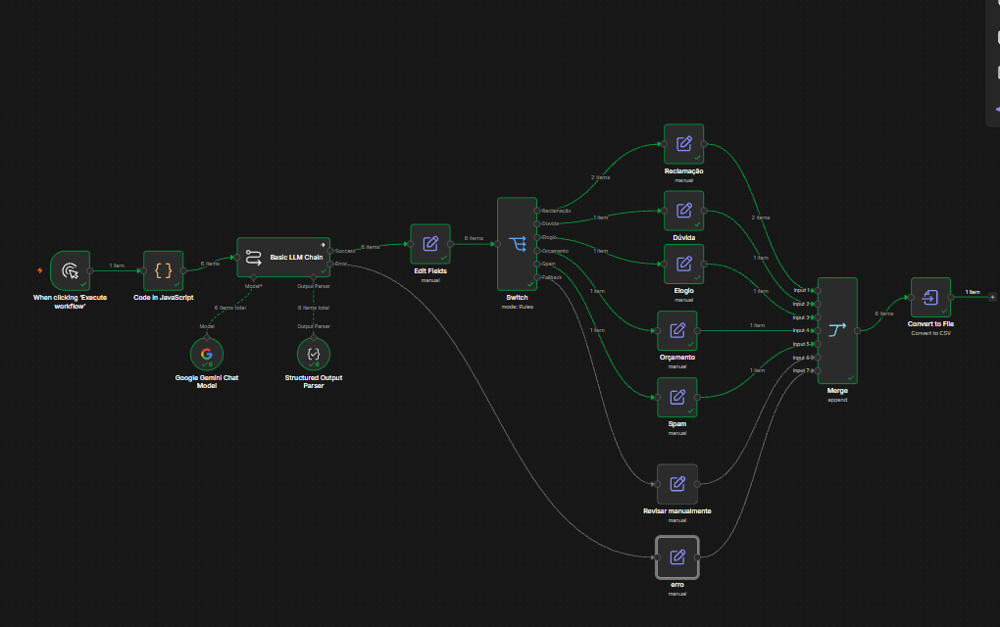
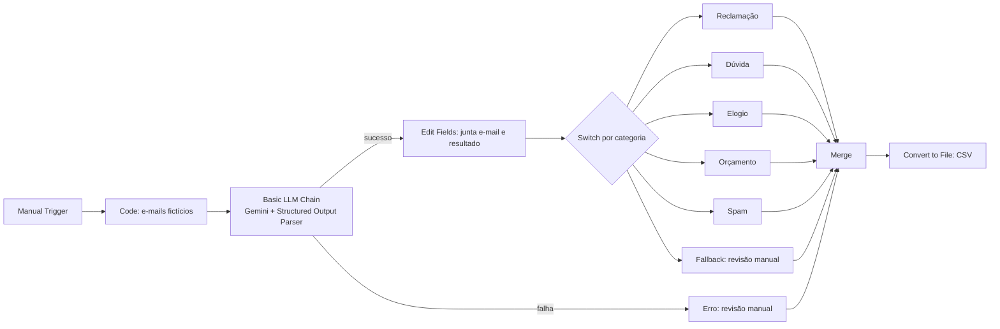

# Agente de Triagem de E-mails com n8n e IA Generativa

Workflow no **n8n** que lê mensagens, classifica cada uma com um LLM (**Gemini**), devolve uma resposta estruturada em JSON, roteia por categoria e gera um registro em CSV com a ação recomendada para cada e-mail.

> **Projeto de aprendizado.** Todas as mensagens são **fictícias** e nenhuma conta de e-mail é conectada. O foco é a lógica de automação, a engenharia de prompt e o tratamento de falhas.



## O que o agente faz

Para cada e-mail recebido, o agente:

1. **Classifica** em uma categoria: `duvida`, `reclamacao`, `elogio`, `orcamento` ou `spam`
2. **Avalia a urgência**: `baixa`, `media` ou `alta`
3. **Resume** a mensagem em uma frase
4. **Sugere um rascunho de resposta** (vazio para spam)
5. **Define uma ação** conforme a categoria (por exemplo, alerta urgente para reclamações com urgência alta)
6. **Registra tudo** em um CSV

## Arquitetura



| Etapa | Nó do n8n | Função |
|---|---|---|
| Entrada | Manual Trigger + Code | Gera 6 mensagens fictícias com `id`, remetente, assunto e corpo |
| IA | Basic LLM Chain + Google Gemini Chat Model | Classifica e escreve o rascunho (temperatura 0) |
| Formato | Structured Output Parser | Força a resposta da IA em JSON previsível |
| Preparo | Edit Fields | Junta os dados originais com o resultado da IA |
| Roteamento | Switch | Separa por categoria (sem diferenciar maiúsculas de minúsculas) |
| Ações | Edit Fields (um por categoria) | Define o campo `acao` |
| Segurança | Saída de erro + Fallback | Garante que nenhum e-mail se perca |
| Saída | Merge + Convert to File | Reúne tudo e gera o CSV |

## Exemplo de resultado

| Remetente | Categoria | Urgência | Ação |
|---|---|---|---|
| ana@exemplo.com | reclamacao | media | Encaminhar ao suporte |
| paulo@exemplo.com | reclamacao | **alta** | **ALERTA URGENTE: encaminhar ao suporte agora** |
| carlos@exemplo.com | duvida | baixa | Rascunho de resposta gerado |
| marta@exemplo.com | elogio | baixa | Registrar e encaminhar ao time |
| joao@exemplo.com | orcamento | baixa | Encaminhar ao comercial |
| promo@spam.com | spam | baixa | Ignorado |

O arquivo completo, com resumo e resposta sugerida, está em [`output/exemplo_saida.csv`](output/exemplo_saida.csv).

## Decisões de projeto

- **Dados fictícios.** Evita expor informações de terceiros e dispensa credenciais de e-mail. O Manual Trigger pode ser trocado por um Webhook ou Gmail Trigger sem mexer no resto do fluxo.
- **Saída estruturada (JSON).** O Structured Output Parser garante campos previsíveis, o que permite rotear e registrar sem depender de texto livre.
- **Temperatura 0.** Reduz a variação entre execuções, embora a classificação por LLM continue sendo probabilística.
- **Rascunho em vez de envio automático.** O agente sugere a resposta, mas não envia: a decisão final fica com uma pessoa (*human in the loop*).
- **Prompt com critérios explícitos de urgência.** Definir o que significa `alta`, `media` e `baixa` deixou a classificação mais consistente.
- **Instrução contra invenção de dados.** O prompt proíbe inventar horários, preços ou políticas e manda usar marcadores como `[inserir horário]`.
- **Nenhum e-mail se perde.** Categorias inesperadas caem no Fallback do Switch, e falhas da IA seguem pela saída de erro, ambos marcados como "Revisar manualmente".

## Problemas encontrados e como foram resolvidos

| Problema | Causa | Solução |
|---|---|---|
| A IA inventou um horário de atendimento | O prompt não proibia | Regra explícita no prompt + marcador `[inserir ...]` |
| A condição de urgência alta não funcionava | Espaço invisível (tab) na frente do valor | `.trim()` nos campos de texto |
| Várias requisições falharam | Limite por minuto da API gratuita do Gemini | Processamento 1 por vez com intervalo de 6 s e *Retry On Fail* |
| Remetente trocado nas linhas do CSV | Associação por posição quebrava quando algum item falhava | A IA devolve o `id` e o nó busca o e-mail original por `id` |
| Urgência variava entre execuções | Critério vago no prompt | Definição explícita de cada nível de urgência |

## Como rodar

### 1. Subir o n8n (gratuito, na sua máquina)

```bash
docker run -it --rm --name n8n -p 5678:5678 -v n8n_data:/home/node/.n8n docker.n8n.io/n8nio/n8n
```

Abra `http://localhost:5678` e crie o usuário local.

### 2. Gerar a chave do Gemini

Crie uma API key gratuita no [Google AI Studio](https://aistudio.google.com). Não é preciso configurar faturamento. As cotas e os modelos gratuitos mudam com frequência, então confira o que está disponível na sua conta.

### 3. Importar o workflow

1. No n8n, abra o menu **⋯** de um workflow novo e escolha **Import from file**
2. Selecione [`workflow/triagem-emails.json`](workflow/triagem-emails.json)
3. No nó **Google Gemini Chat Model**, crie a credencial colando sua chave e escolha um modelo Flash-Lite disponível
4. Clique em **Execute workflow** (leva cerca de 30 a 40 segundos por causa do intervalo entre requisições)
5. No nó **Convert to File**, baixe o CSV gerado

## Limitações e próximos passos

- [ ] Trocar o Manual Trigger por **Webhook** e depois por **Gmail Trigger**
- [ ] Criar o rascunho de resposta diretamente na caixa de e-mail (sem enviar)
- [ ] Gravar o registro em **Google Sheets** ou banco de dados em vez de CSV
- [ ] Preservar remetente e assunto também nos itens que caem na saída de erro
- [ ] Avaliar a qualidade da classificação com um conjunto maior de mensagens rotuladas e medir a acurácia
- [ ] Analisar o histórico registrado (volume por categoria, horários de pico, tempo de resposta)

## Estrutura do repositório

```
.
├── README.md
├── workflow/
│   └── triagem-emails.json
├── output/
│   └── exemplo_saida.csv
└── imagens/
    └── canvas.png
```

## Tecnologias

n8n (self-hosted com Docker) · Google Gemini · LangChain (nós de IA do n8n) · JavaScript (expressões e nó Code)

## Autor

**[Gustavo Costa Nascimento]** · [LinkedIn](https://www.linkedin.com/in/gustavo-costa-nascimento/) · [GitHub](https://github.com/GustavoCosta10)
